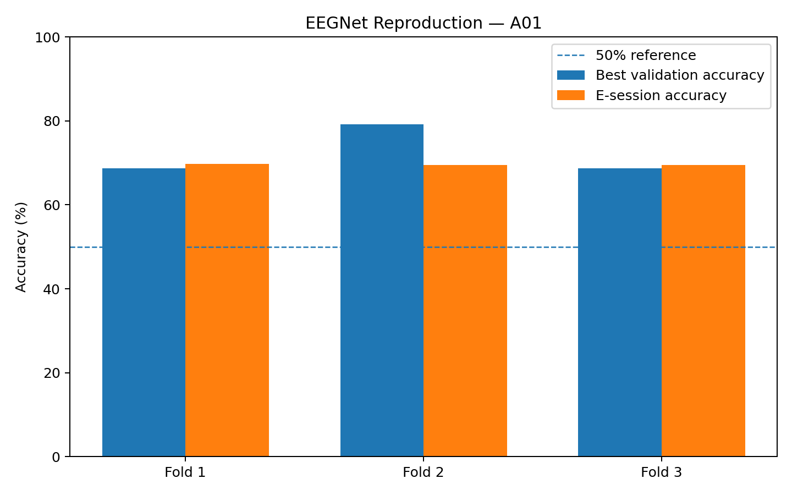
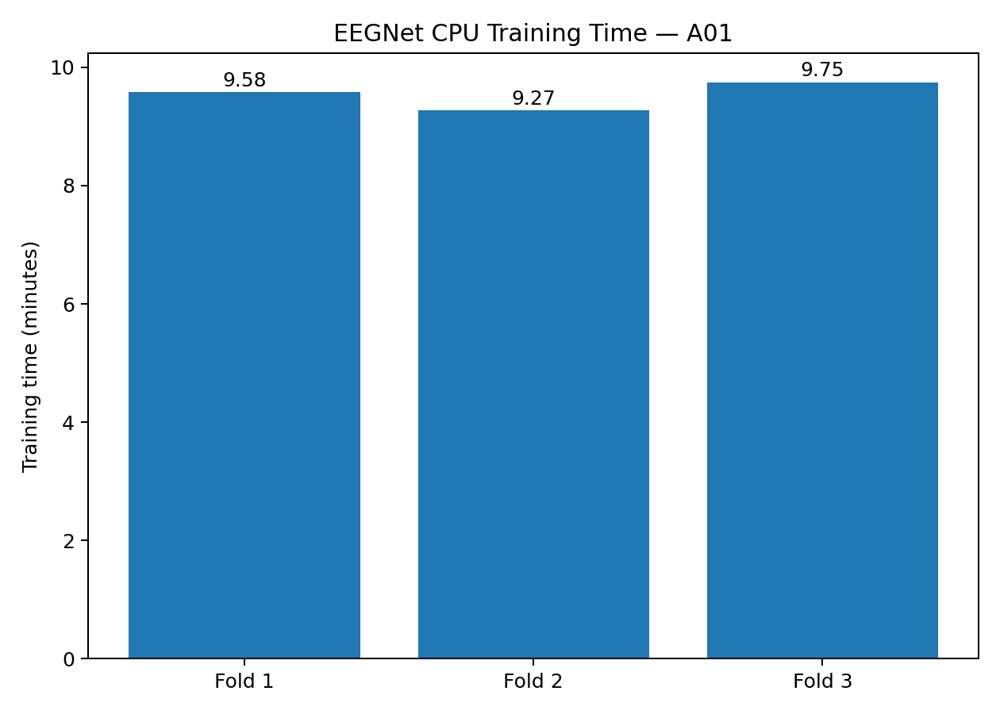

# EEGNet Reproduction on BCI Competition IV-2a

A lightweight reproduction of **EEGNet** for motor-imagery EEG classification, using the original authors' public EEGModels implementation.

> **Actual run documented here:** Google Colab CPU, subject **A01**, 3-fold training, 500 epochs, 1,796 parameters, **69.56% mean E-session accuracy**, and **28.61 minutes total CPU training time**.

## Paper

V. J. Lawhern, A. J. Solon, N. R. Waytowich, S. M. Gordon, C. P. Hung, and B. J. Lance.

**EEGNet: a compact convolutional neural network for EEG-based brain–computer interfaces.**

*Journal of Neural Engineering*, 15(5), 056013, 2018.

DOI: https://doi.org/10.1088/1741-2552/aace8c

### Original author implementation

https://github.com/vlawhern/arl-eegmodels

The ARL repository states that it is intended to facilitate reproducible EEG research and contains the EEGNet implementation.

## Project summary

```text
BCI Competition IV-2a
        |
        v
22 EEG channels + 3 EOG channels
        |
        v
250 Hz -> 128 Hz resampling
        |
        v
4–40 Hz band-pass filter
        |
        v
Exponential moving standardization
        |
        v
0.5–2.5 s post-cue window
        |
        v
22 × 256 × 1 EEGNet input
        |
        v
Original EEGNet-8,2
        |
        v
4-class motor-imagery prediction
        |
        v
A01 E-session evaluation
```

## Dataset

**BCI Competition IV Dataset 2a** contains recordings for four motor-imagery classes: left hand, right hand, feet, and tongue. The dataset provides 22 EEG channels and 3 EOG channels at 250 Hz.

Official download page:
https://www.bbci.de/competition/iv/download/

Dataset archive used:
https://www.bbci.de/competition/download/competition_iv/BCICIV_2a_gdf.zip

The evaluation session does not contain the true class labels in the GDF. The official evaluation labels are distributed separately.

Official evaluation labels:
https://www.bbci.de/competition/iv/results/ds2a/true_labels.zip

## Model

The model is imported at runtime from the original ARL implementation:

```python
from EEGModels import EEGNet
```

Configuration used in the documented run:

```python
EEGNet(
    nb_classes=4,
    Chans=22,
    Samples=256,
    dropoutRate=0.5,
    kernLength=32,
    F1=8,
    D=2,
    F2=16,
    norm_rate=0.25,
    dropoutType="Dropout"
)
```

Observed parameter count: **1,796**.

### Architecture

```text
Input: 22 × 256 × 1
        |
        v
Temporal Conv2D
F1 = 8
Kernel = 1 × 32
        |
        v
Depthwise Conv2D
Spatial filtering
Depth multiplier = 2
        |
        v
Average Pooling + Dropout
        |
        v
Separable Conv2D
F2 = 16
Kernel = 1 × 16
        |
        v
Average Pooling + Dropout
        |
        v
Flatten -> Dense(4) -> Softmax
```

## Reproduction protocol

This repository documents a **subject A01** reproduction.

### Training session

`A01T.gdf`

288 trials, balanced:

```text
Left hand   72
Right hand  72
Feet        72
Tongue      72
```

### Evaluation session

`A01E.gdf`

288 trials. The official true labels are loaded from `A01E.mat`.

### Signal processing

- Keep the first 22 EEG channels.
- Resample 250 Hz -> 128 Hz.
- Band-pass filter: 4–40 Hz.
- Exponential moving standardization.
- Training/evaluation trial window: 256 samples.
- Training T-session window: 0.5–2.5 s after the motor-imagery cue.
- Evaluation E-session window: 2.5–4.5 s after trial start, because the cue occurs 2 s after trial onset.

### Training

- 3 contiguous folds of 96 trials.
- 192 training trials per fold.
- 96 validation trials per fold.
- 500 epochs.
- Batch size 64.
- Adam optimizer.
- Sparse categorical cross-entropy in the reproduction script.
- Best validation checkpoint retained.
- Final evaluation on all 288 A01E trials.

## Results from the actual run

| Fold | Best validation accuracy | E-session accuracy | CPU training time |
|---|---:|---:|---:|
| 1 | 68.75% | 69.79% | 9.58 min |
| 2 | 79.17% | 69.44% | 9.27 min |
| 3 | 68.75% | 69.44% | 9.75 min |
| **Mean** | — | **69.56%** | **28.61 min total** |





## Reproduction boundary

The reported 69.56% is specifically the result of this A01 run and its exact preprocessing, fold split, random seed, and Colab software environment. It should **not** be presented as the overall published EEGNet benchmark across all nine subjects.

This repository is a **research reproduction record**, not a claim that the paper's complete benchmark table was exactly reproduced.

## Colab

Use a fresh Google Colab notebook and select:

**Runtime -> Change runtime type -> CPU**

Then:

```bash
!pip -q install tensorflow==2.20.0 mne scipy pandas matplotlib
!git clone -q https://github.com/vlawhern/arl-eegmodels.git /content/arl-eegmodels
```

Download the dataset and official labels, then run `reproduce_eegnet.py`.

The included notebook is:

`notebooks/EEGNet_A01_Reproduction.ipynb`

## Repository structure

```text
eegnet-reproduction/
|
|-- README.md
|-- METHODS.md
|-- RESULTS.md
|-- START_HERE.md
|-- CITATION.cff
|-- requirements-colab.txt
|-- reproduce_eegnet.py
|-- .gitignore
|
|-- notebooks/
|   `-- EEGNet_A01_Reproduction.ipynb
|
|-- figures/
|   |-- fold_accuracy.png
|   `-- training_time.png
|
`-- results/
    |-- results.json
    `-- a01_results.csv
```

## Attribution

Please cite the original EEGNet paper:

```bibtex
@article{Lawhern2018,
  author = {Vernon J. Lawhern and Amelia J. Solon and Nicholas R. Waytowich and Stephen M. Gordon and Chou P. Hung and Brent J. Lance},
  title = {EEGNet: a compact convolutional neural network for EEG-based brain-computer interfaces},
  journal = {Journal of Neural Engineering},
  volume = {15},
  number = {5},
  pages = {056013},
  year = {2018},
  doi = {10.1088/1741-2552/aace8c}
}
```

## License

The EEGNet implementation is fetched from the original ARL repository at runtime. Respect the original repository's license and the BCI Competition dataset terms. The documentation and reproduction wrapper in this repository are separate from the third-party model implementation.
